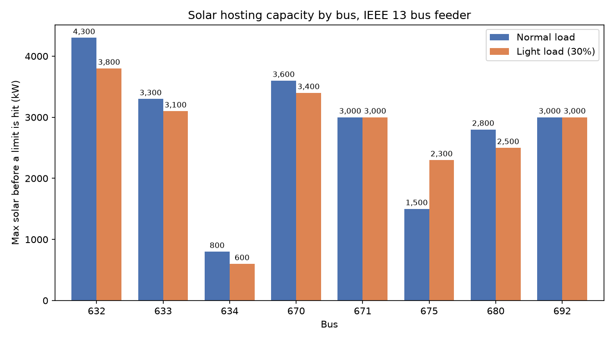
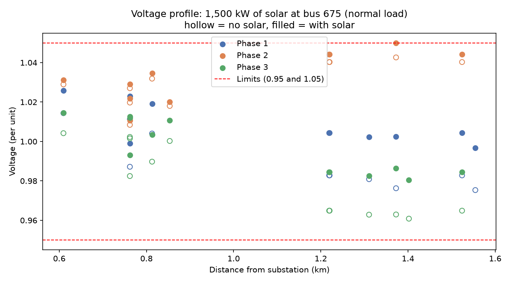

# Solar Hosting Capacity on the IEEE 13 Bus Feeder

How much solar can each spot on a distribution feeder take before something breaks? This project answers that for the IEEE 13 bus test feeder using Python and OpenDSS.

## Why I built this

My other project, Grid Line, looks at interconnection queues using Berkeley Lab's Queued Up data and shows that projects wait years to connect. This project looks at one physical reason why. Local grids have hosting limits, and once a project goes past them the utility has to study and pay for upgrades before it can connect.

## What it does

For each of the 8 three phase buses on the feeder, the script:

1. Loads the feeder fresh
2. Adds a solar system and grows it 100 kW at a time
3. Re solves the grid after every step and checks three limits:
   * **Overvoltage:** any customer node above 1.05 per unit
   * **Undervoltage:** any customer node below 0.95 per unit
   * **Overload:** a line or transformer carrying more current than it's rated for
4. Records the biggest size that passed and which limit stopped it

It runs everything twice: at normal load, and at light load (30% of normal), which stands in for a mild sunny midday when solar is high and demand is low.

## Results

```
Bus   Normal load   Light load   What stopped it (normal / light)
632     4,300 kW     3,800 kW    overvoltage / overload on Line.650632
633     3,300 kW     3,100 kW    overload on Line.632633 / same
634       800 kW       600 kW    overload on Transformer.xfm1 / same
670     3,600 kW     3,400 kW    overvoltage / overload on Line.632670
671     3,000 kW     3,000 kW    overvoltage / overvoltage
675     1,500 kW     2,300 kW    overvoltage / overvoltage
680     2,800 kW     2,500 kW    overload on Line.671680 / overvoltage
692     3,000 kW     3,000 kW    overvoltage / overvoltage
```





## What I found

**Where you connect matters a lot.** At normal load, hosting capacity ranged from 800 kW to 4,300 kW on the same feeder. Bus 632, right next to the substation, took the most. Bus 634 took the least.

**Bus 634 is limited by a small transformer, not distance.** It sits behind a 500 kVA transformer that steps down to 480 V, and that transformer was already at 107% of its rating before any solar. Solar first covers the bus's own load, then the extra flows backward through the transformer until it hits that limit. In the real world the fix is a bigger transformer, and the developer pays for it.

**Bus 675 hits overvoltage first.** It's near the far end of the feeder, and its phase 2 carries very little load (68 kW vs 485 kW on phase 1), so that phase starts high. Solar pushes all three phases up about the same amount, so the phase that starts highest crosses 1.05 first. The voltage profile chart shows this.

**Light load isn't always the worst case.** Five buses dropped 200 to 500 kW at light load, two held the same, and bus 675 went up 800 kW. The voltage regulator boosts less when load is light, which leaves more room under 1.05 at the far end. At 632 and 670 the binding limit also switched from voltage to line overload, because power flowing backward toward the substation hit the line ratings first.

## Assumptions and limits

* **Regulator taps are locked** after they settle for each load level. Regulators react in seconds to minutes and solar can swing faster than that, so this is the usual cautious assumption.
* **Line ratings are OpenDSS defaults.** The IEEE 13 file doesn't include real line ratings, so OpenDSS uses 400 amps. Three elements (and the 634 transformer) were already over 100% before any solar. For those, solar only fails if it makes them worse than where they started. Results on overload limited buses depend on these default ratings.
* **One solar site at a time**, at unity power factor (no reactive power support from the inverter).
* **Snapshot study.** Two load levels, not a full year of hourly load and sun data.
* Voltage checks skip the substation and regulator nodes, since those aren't customers.

## Next steps

* Turn on smart inverter volt var control and see how much it raises the limits
* Test solar spread across several buses at once
* Run a full year of hourly load and solar shapes instead of two snapshots

## How to run

```
python -m venv .venv
.\.venv\Scripts\Activate.ps1
pip install -r requirements.txt
python baseline.py
python hosting_capacity.py
python make_charts.py
```

`baseline.py` downloads the IEEE 13 bus files from the OpenDSS test case repo the first time it runs.

## Files

* `baseline.py`: downloads and solves the feeder, prints voltage at every node
* `hosting_capacity.py`: runs the hosting capacity sweep at normal and light load, saves `results/hosting_capacity.csv`
* `make_charts.py`: makes the two charts in `results/`

## Tools

Python, OpenDSS (through OpenDSSDirect.py), pandas, matplotlib